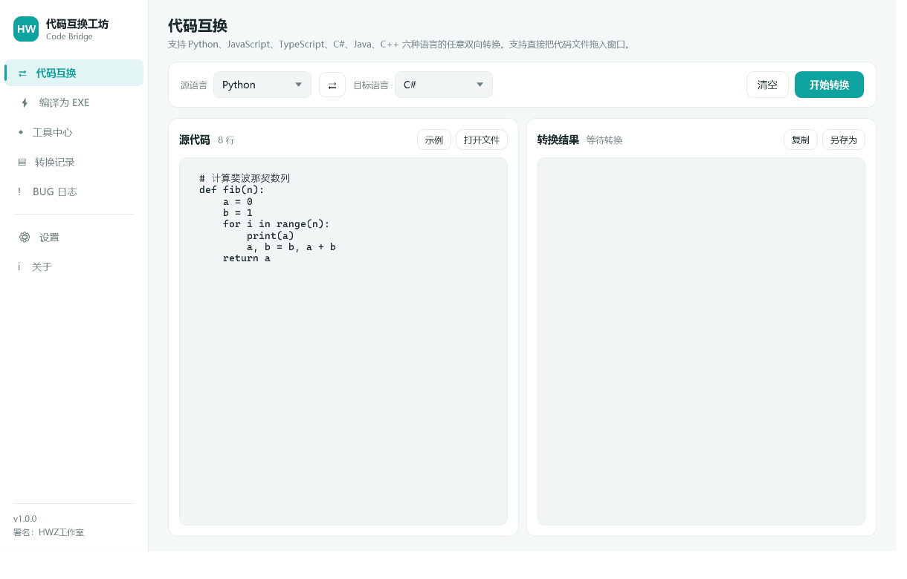
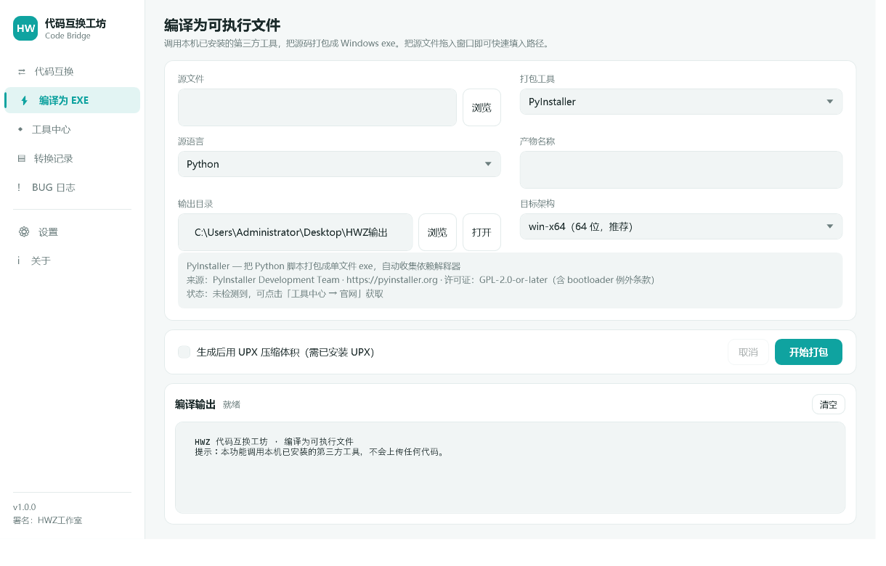
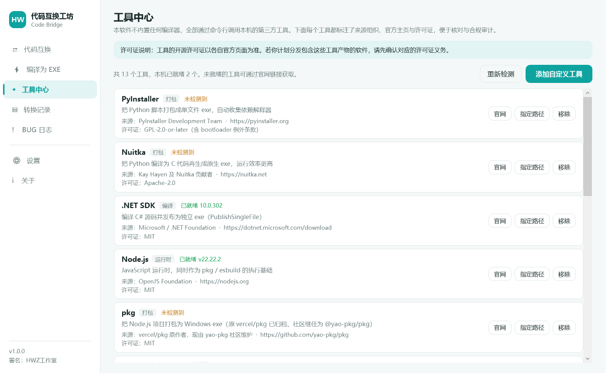
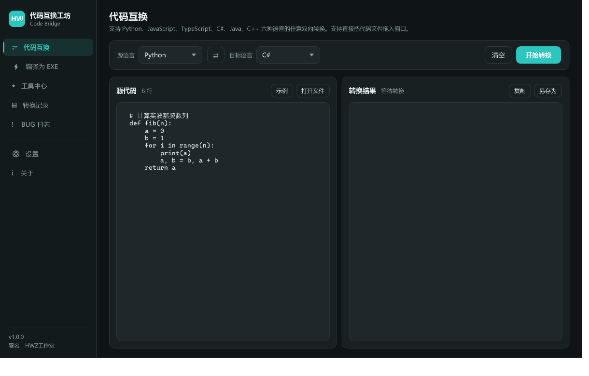

# HWZ 代码互换工坊 · Code Bridge

> 主流编程语言代码互换 + 源码打包为 Windows 可执行文件的一体化工具。
> 提供 **Windows 桌面版** 与 **纯前端网页版** 两个形态，共用同一套转换引擎。

**署名：HWZ工作室** · 版本 1.0.2 beta

---

## 这是什么

一个把"读起来像另一种语言"这件事做实的工具：把 Python 脚本换成 C#，把一段 Java 换成 Python，再顺手生成一条能产出 exe 的打包命令。

它不做全文检索式的关键词替换，而是**按缩进块与花括号块的结构关系做重写**：

- Python 的 `if/elif/else`、`for`、`try/except`、`def`、`class` 会正确映射到目标语言的分块语法
- 反向转换时，`Program` / `Main` 这类容器类会被识别为"透明块"并剥离，避免生成多余的缩进层级
- 无法等价表达的部分（装饰器、生成器、`with`、`sep/end` 参数等）**逐行给出提示**，而不是静默产出错代码

## 支持的语言

Python · JavaScript · TypeScript · C# · Java · C++

六种语言任意两两互换，共 **30 种转换组合**。

| 源 \ 目标 | Python | JS | TS | C# | Java | C++ |
|---|:---:|:---:|:---:|:---:|:---:|:---:|
| Python | — | ✅ | ✅ | ✅ | ✅ | ✅ |
| JavaScript | ✅ | — | ✅ | ✅ | ✅ | ✅ |
| TypeScript | ✅ | ✅ | — | ✅ | ✅ | ✅ |
| C# | ✅ | ✅ | ✅ | — | ✅ | ✅ |
| Java | ✅ | ✅ | ✅ | ✅ | — | ✅ |
| C++ | ✅ | ✅ | ✅ | ✅ | ✅ | — |

## 两个版本

| | 桌面版 | 网页版 |
|---|---|---|
| 形态 | 单个 `exe`，免安装 | 纯静态页面，浏览器打开即用 |
| 位置 | [Releases](https://github.com/HWZ-ch/hwz-code-bridge/releases/latest) 下载 | `web/` |
| 运行环境 | Windows + .NET 8（已内置运行时） | 任意现代浏览器 |
| 代码互换 | 全部 30 种组合 | 全部 30 种组合（同一套规则） |
| 可执行文件 | 真实调用本机工具链编译出 exe | 生成打包命令 + 可下载 `.bat` 脚本 |
| 记录与设置 | 存本地 JSON 文件 | 存浏览器 localStorage（上限 200 条） |
| 代码隐私 | 全程本机 | 全程浏览器内，不上传 |

> 浏览器沙箱无法访问文件系统与命令行，因此网页版不执行编译，而是产出与桌面版完全一致的打包命令。
> 这是能力边界，不是功能缺失。

## 自动更新

桌面版内置基于 GitHub Releases 的更新机制：

- **启动时自动检查**：默认开启，检查间隔 24 小时；发现新版本才提示，网络异常时静默不打扰
- **手动检查**：「设置 → 更新」或「关于 → 检查更新」
- **更新流程**：比对版本号 → 显示更新说明与安装包大小 → 下载并校验 SHA256 → 生成替换脚本 → 重启完成替换
- **可控性**：支持「稍后提醒」与「跳过此版本」，后者不会再次提示同一版本
- **完整性校验**：若 Release 资源带有 `digest` 字段，下载后会核对 SHA256，不一致则中止并删除临时文件

更新源固定为 `HWZ-ch/hwz-code-bridge` 的 **Latest Release**。发布新版本的约定：

1. 修改 `HWZCodeBridge.csproj` 中的 `<Version>`
2. 重新 `dotnet publish` 生成单文件 exe
3. 在 GitHub 创建对应 tag（如 `v1.0.2`）的 Release，把 exe 作为资源上传
4. 已安装的旧版本会在下次检查时发现并提示

> 运行中的 exe 无法自我覆盖，因此替换由一段临时批处理脚本在进程退出后完成，随后自动重启新版本。

## 公告系统

公告保存在仓库根目录的 **`announcement.json`**，桌面版与网页版在每次打开时拉取并弹窗展示。

```json
{
  "id": "2026-11-03-01",
  "title": "公告标题",
  "content": "正文，支持 \n 换行",
  "level": "info",
  "enabled": true,
  "publishedAt": "2026-11-03T22:00:00+08:00",
  "actionText": "查看项目主页",
  "actionUrl": "https://github.com/HWZ-ch/hwz-code-bridge"
}
```

| 字段 | 说明 |
|---|---|
| `level` | `info` 青绿 / `warn` 橙 / `important` 红，决定弹窗配色 |
| `enabled` | `false` 时客户端完全不显示公告 |
| `actionText` + `actionUrl` | 可选的跳转按钮，仅接受 http/https |
| `publishedAt` | ISO 8601 时间，界面显示为本地时间 |

客户端通过 **GitHub Contents API** 读取（而非 raw 域名），因此不受部分网络环境下 `raw.githubusercontent.com` 解析异常的影响。任何拉取失败都静默处理，不影响程序启动。

### 公告编辑器

配套的 **HWZ 公告编辑器**（`dist/HWZAnnouncementTool.exe`，随 Release 一同分发）用于维护公告：

- 可视化编辑标题、正文、级别、启用状态、跳转按钮
- 右侧实时预览，与用户在软件里看到的效果一致
- **读取线上公告**：把当前线上版本拉回编辑器修改
- **一键发布**：调用 GitHub Contents API 直接提交到仓库（需要 Contents: Read and write 权限的 Token）
- **导出 JSON**：不想用 Token 时，导出文件后手动上传覆盖即可

> Token 以 Base64 形式保存在本机 `%AppData%\HWZ工作室\公告编辑器\settings.json`，这是防肩窥的编码而非加密，请勿在公用电脑上保存。

## 界面

**代码互换（浅色）**



**编译为可执行文件**



**工具中心（第三方来源与许可证）**



**深色主题**



## 目录结构

```
.
├── HWZCodeBridge/              # 桌面版（.NET 8 + WPF）
│   ├── Convert/                #   转换引擎
│   │   ├── PythonParser.cs     #     Python 缩进块 → 节点树
│   │   ├── PythonToBraceConverter.cs
│   │   ├── BraceToPythonConverter.cs
│   │   ├── BraceToBraceConverter.cs
│   │   └── CodeConverter.cs    #     路线分派
│   ├── Build/                  #   编译编排
│   │   ├── ToolRegistry.cs     #     第三方工具注册表（含来源/许可证）
│   │   └── BuildService.cs     #     命令行调用与日志流
│   ├── Updating/               #   自动更新
│   │   ├── UpdateService.cs    #     GitHub Releases 检查/下载/自替换
│   │   └── UpdateUi.cs         #     检查与提示的统一交互
│   ├── Announcements/          #   公告
│   │   ├── Announcement.cs     #     公告数据模型
│   │   └── AnnouncementService.cs
│   ├── Views/                  #   8 个页面 + 更新/公告对话框
│   └── Themes/                 #   浅色 / 深色主题
├── HWZAnnouncementTool/        # 公告编辑器（独立 WPF 程序）
├── announcement.json           # 线上公告内容（客户端读取此文件）
├── web/                        # 网页版（纯静态，无依赖）
│   ├── index.html
│   └── assets/
│       ├── engine.js           #   语言目录 + Python 解析器
│       ├── engine-py2brace.js  #   Python → C 系
│       ├── engine-brace2py.js  #   C 系 → Python
│       ├── engine-convert.js   #   C 系互转 + 统一入口
│       └── app.js              #   界面交互
├── Tests/                      # 引擎与打包流程的验证程序
├── RenderTest/                 # 界面离屏渲染截图工具
└── dist/
    └── preview/                # 界面截图（桌面版成品见 Releases）
```

## 构建与运行

### 桌面版

需要 [.NET 8 SDK](https://dotnet.microsoft.com/download)。

```bash
cd HWZCodeBridge
dotnet build -c Release
dotnet run -c Release
```

打包为免安装单文件：

```bash
dotnet publish -c Release -r win-x64 --self-contained true \
  -p:PublishSingleFile=true \
  -p:EnableCompressionInSingleFile=true \
  -p:IncludeNativeLibrariesForSelfExtract=true \
  -o ../dist
```

### 网页版

无构建步骤，任意静态服务器即可：

```bash
cd web
python -m http.server 8080
# 打开 http://localhost:8080
```

### 验证

```bash
cd web && node test.js     # 转换引擎：六语言输出与往返一致性
cd web && node check.js    # 页面元素与资源引用一致性
```

## 编译为可执行文件

工具本身**不内嵌任何编译器**，只负责编排本机已安装的第三方工具链。所有调用都会在日志中打印完整命令，便于审计与复现。

| 源语言 | 可选工具 | 产物 |
|---|---|---|
| Python | PyInstaller / Nuitka | 单文件 exe |
| C# | .NET SDK（`dotnet publish`） | 自包含单文件 exe |
| JavaScript / TypeScript | pkg（+ esbuild） | 单文件 exe |
| C / C++ | GCC（MinGW-w64）/ Clang | 静态链接 exe |
| Java | JDK `jpackage` | 自带运行时的应用目录 |
| Go / Rust | go build / rustc | 静态 exe |

### 第三方工具与来源

以下工具均为第三方开源项目，本项目不修改其代码，仅通过命令行调用。**许可证以各项目官方页面为准**。

| 工具 | 来源组织 | 许可证 | 官方主页 |
|---|---|---|---|
| PyInstaller | PyInstaller Development Team | GPL-2.0-or-later（含 bootloader 例外） | https://pyinstaller.org |
| Nuitka | Kay Hayen 及贡献者 | Apache-2.0 | https://nuitka.net |
| .NET SDK | Microsoft / .NET Foundation | MIT | https://dotnet.microsoft.com |
| pkg | yao-pkg 社区（原 vercel/pkg 已归档） | MIT | https://github.com/yao-pkg/pkg |
| GCC / MinGW-w64 | GNU 项目 / MinGW-w64 团队 | GPL-3.0-or-later | https://www.mingw-w64.org |
| LLVM Clang | LLVM 项目 | Apache-2.0 WITH LLVM-exception | https://llvm.org |
| Go 工具链 | Google / Go 贡献者 | BSD-3-Clause | https://go.dev |
| Rust | Rust 项目 | MIT OR Apache-2.0 | https://www.rust-lang.org |
| JDK / jpackage | OpenJDK 社区 | GPL-2.0 WITH Classpath-exception | https://openjdk.org |
| Node.js | OpenJS Foundation | MIT | https://nodejs.org |
| UPX | M. Oberhumer, L. Molnar, J. Reiser | GPL-2.0-or-later | https://upx.github.io |
| ILSpy | ICSharpCode 团队 | MIT | https://github.com/icsharpcode/ILSpy |
| PE-bear | hasherezade | GPL-3.0 | https://github.com/hasherezade/pe-bear |

## 已知限制

- 转换基于语法规则重写，**不做完整语义分析与类型推导**。涉及反射、元编程、异步调度、装饰器、运算符重载的代码，转换结果可能无法直接编译，需人工复核。
- 类型信息缺失处使用动态类型占位（C# `dynamic`、TS `any`、Java `Object`、C++ `auto`），建议在目标语言中替换为具体类型。
- `try` 块内声明的变量在 C#/Java 中作用域仅限该块，跨块使用时需手动提到外层。
- 网页版受浏览器沙箱限制，不执行编译，只生成命令。
- 桌面版数据保存在 `%AppData%\HWZ工作室\HWZ代码互换工坊\`。

## 免责声明

本项目仅提供代码结构与语法的辅助转换，不对转换结果的正确性、安全性、合规性作任何担保。使用前请自行复核，并确保你对所转换与编译的代码拥有相应权利。

## 许可

本仓库代码由 HWZ工作室 编写。若你计划分发包含第三方工具产物的软件，请先确认对应工具的许可证义务。

---

**HWZ 代码互换工坊** · 由 HWZ工作室 设计与开发
